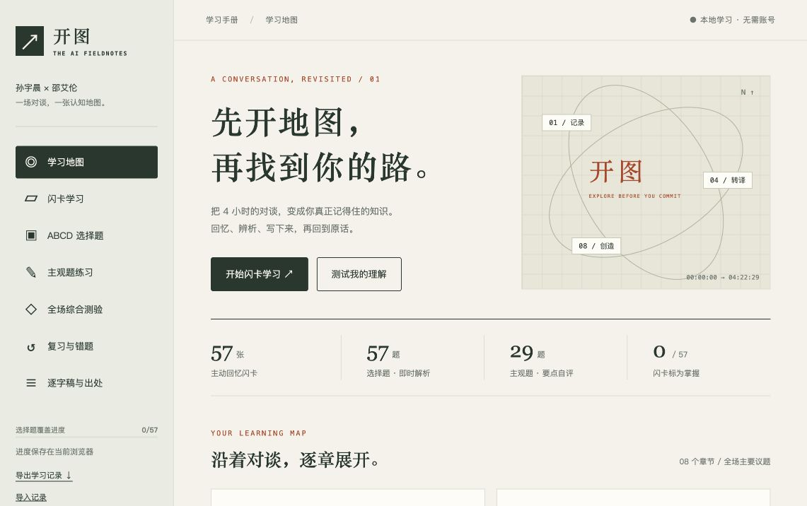

# 开图 · AI 时代学习手册

孙宇晨 × 邵艾伦 4 小时 22 分对谈的学习网页：闪卡、ABCD 选择题、主观题和全场测验。



[详细使用指南](docs/使用指南.md) · [开发维护说明](docs/开发维护.md) · [原始笔记说明](README.notes.md)

## 开始学习

**最快方式：** 在仓库选择 Code → Download ZIP，解压后用浏览器打开 `index.html`。GitHub 文件预览只显示代码，不运行网页。

也可以克隆仓库，使用 Bun 启动本地网页：

```sh
git clone https://github.com/Daltan/justin-sun-alan-shao-study.git
cd justin-sun-alan-shao-study
bun install --frozen-lockfile
bun run start
```

访问 http://127.0.0.1:4318 。固定使用同一浏览器和地址，便于保留学习进度。

## 内容与功能

- 8 个主题章节，覆盖整场访谈的主要议题。
- 57 张闪卡：先主动回忆，再翻开答案；按自评设置复习时间。
- 57 道 ABCD 单选题：随机排列选项，显示解析，答错进入错题列表。
- 29 道主观题：保存文字回答，对照三个要点手动自评。
- 综合测验：每章随机抽取 2 道选择题、1 道主观题，共 24 题。交卷前隐藏答案；选择题自动评分，主观题单独自评。
- 错题与到期闪卡复习、学习记录导出与导入。
- 原始逐字稿全文检索、题目来源分段和视频时间点。

网页无需账号或 API 密钥。题库、逐字稿和页面代码均打包在一个 HTML 中；外部视频和仓库链接需要网络。进度存在浏览器本地，不自动跨设备同步。定期导出 JSON 备份；导入会替换该浏览器已有进度。

闪卡自评：再学一次约 1 分钟后到期、有点印象 1 天后到期、已经掌握 3 天后到期。掌握数量代表个人自评，不代表客观认证。

## 来源与理解边界

原仓库：[wousp112/justin-sun-alan-shao-ai-notes](https://github.com/wousp112/justin-sun-alan-shao-ai-notes)

克隆基准：`db8ddd2c2578837a3c900901b24a3108a290d1ea`。

原视频：https://www.youtube.com/watch?v=0Z-vhBvBmUY

保留原始逐字稿、精华和教程，并记录来源提交；原仓库历史保留在本地克隆中，原项目介绍在 `README.notes.md`。原笔记、教程、AGENT.md 的授权为 CC BY 4.0，见 `LICENSE.upstream`；访谈和逐字稿版权属于孙宇晨、邵艾伦。

题库为学习用转述，答案检验“嘉宾在访谈中如何表达”，不把嘉宾的医学、金融、技术、历史说法自动当成已验证事实。逐字稿为机器转录，可能有词语或说话人识别错误；精确引用请回看视频。题库覆盖主要议题，并非逐句考查全部发言。

## 开发与验证

```sh
bun run build
bun test
bun x tsc --noEmit
```

- `app/content.ts`：题库与章节。
- `app/main.ts`：学习、测验、进度与导入导出。
- `app/style.css`：桌面与移动布局。
- `app/build.ts`：生成单文件网页。
- `app/server.ts`：仅监听本机的本地网页服务。
- `app/app.test.ts`：交互与内容完整性测试。

已通过 10 个自动化功能测试与 TypeScript 检查，验证 57 道题均有逐字稿时间点。2026-10-12 已通过实际浏览器查看学习地图、闪卡、选择题和主观题，并保存桌面截图。移动布局尚未单独验收。

仓库：https://github.com/Daltan/justin-sun-alan-shao-study

当前未启用 GitHub Pages；使用网页请下载打开或启动本地服务。


应用源码采用仓库创建时指定的 MIT 许可证（`LICENSE`）。上游笔记材料的 CC BY 4.0 授权和访谈版权声明保存在 `LICENSE.upstream`；MIT 不覆盖第三方访谈与逐字稿。
