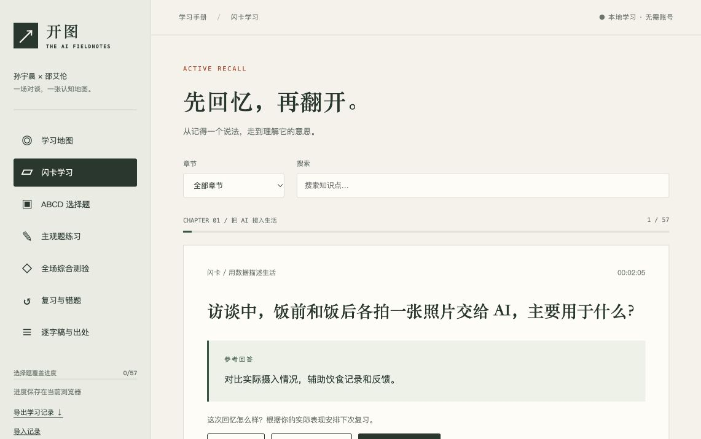
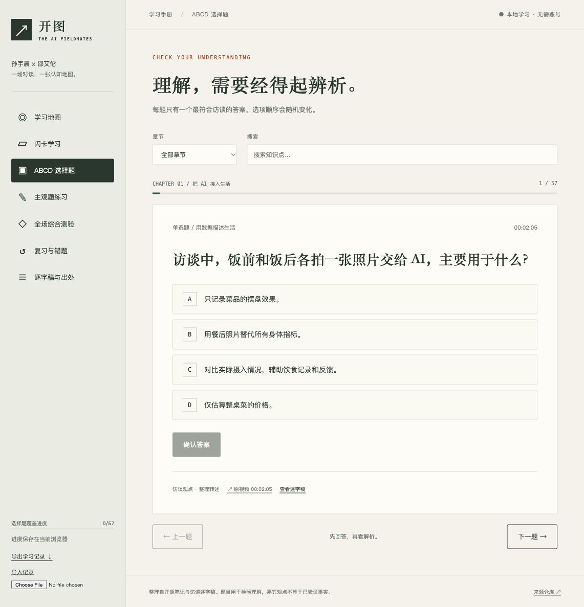
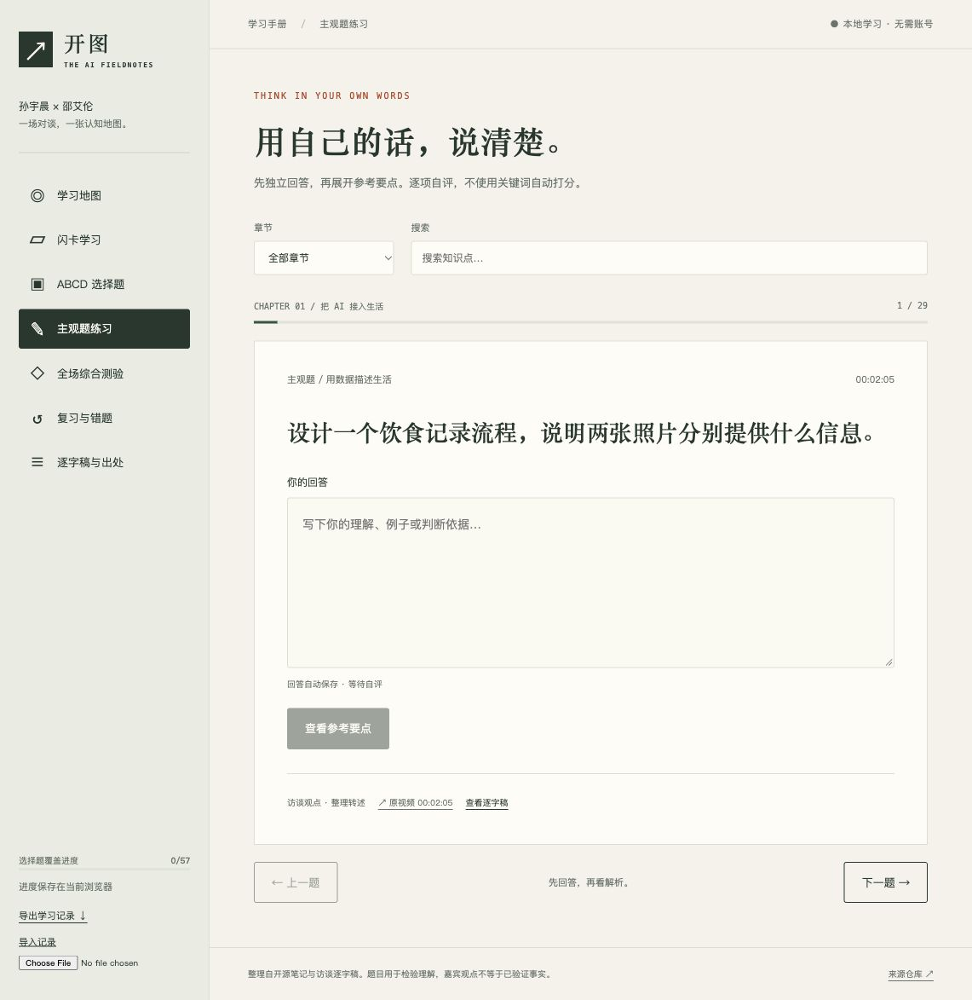

# 使用指南

## 下载和打开

无需安装 AI 工具、创建账号或填写 API 密钥。

在仓库首页选择 **Code → Download ZIP**，解压后用浏览器打开根目录 `index.html`。网页的题库、样式和逐字稿均已包含在这个文件里。GitHub 的文件预览页面只展示源码，不会运行学习网页。

如果需要稳定地保存进度，建议使用本地服务：

```sh
git clone https://github.com/Daltan/justin-sun-alan-shao-study.git
cd justin-sun-alan-shao-study
bun install --frozen-lockfile
bun run start
```

打开 http://127.0.0.1:4318/ 。关闭服务后重新运行 `bun run start` 即可。始终使用同一个浏览器、地址和端口；`localhost` 与 `127.0.0.1` 是不同的存储来源，学习记录不会自动共享。

## 推荐学习顺序

1. 在学习地图选择一个章节，先用闪卡主动回忆。
2. 再做这个章节的 ABCD 选择题，确认能区分不同解释。
3. 做主观题，用自己的话说明概念、例子和适用条件。
4. 完成全场综合测验，查找跨章节的薄弱点。
5. 到“复习与错题”回顾答错的选择题和到期闪卡。

## 闪卡

先尝试回答，再点击“翻开答案”。也可在非输入框焦点下按空格翻面，按右方向键前进。

| 自评 | 下一次复习 |
| --- | --- |
| 再学一次 | 约 1 分钟后 |
| 有点印象 | 1 天后 |
| 已经掌握 | 3 天后 |

首页“闪卡标为掌握”是你的自评数量，和选择题覆盖进度是两个不同指标。闪卡按章节或搜索内容筛选；搜索输入完成后按 Enter 或移开焦点生效。



## ABCD 选择题

选中一个选项后点击“确认答案”。每道题只有一个最符合访谈表达的答案。选项顺序随机变化，所以要理解内容，不要记字母。

答错后会显示解析并加入待复习清单。在错题练习中答对后，该题移出待复习清单。未完成过的选择题不会算作已经覆盖。



## 主观题

先写下独立回答，再点击“查看参考要点”。回答在输入时自动保存在当前浏览器。对照三个要点，勾选你认为已经覆盖的部分，点击“保存自评”。

这是人工自评，应用没有调用模型自动评分，也不会通过关键词出现次数判断回答质量。自评记录用于复习，不是考试认证。



## 综合测验

每次抽取 24 题：每个章节 2 道选择题和 1 道主观题，共 16 道选择题、8 道主观题。同一份试卷不会重复抽取同一知识点。

使用答题导航跳转题目。已有答案以深色标示，作答内容自动保存，离开后可以回来继续。交卷前不显示正确答案。

交卷后：

- 选择题自动判分，未答题计为未答并加入复习。
- 展示各章节的选择题表现。
- 主观题显示你的原回答和参考要点，仍由你手动自评。
- “重新抽题”会替换当前试卷；历史保留选择题成绩和主观题已答数量，旧试卷的逐题答案不会作为独立试卷归档。

## 进度备份与迁移

左侧“导出学习记录”下载 JSON 文件，包含闪卡复习时间、选择题状态、主观题回答、当前测验和成绩历史。

在另一台设备或另一个浏览器中打开应用，选择“导入记录”，选中该 JSON 文件。确认后会替换目标浏览器已有记录，建议导入前先导出目标记录备份。

记录只保存在本地，不会上传到 GitHub，不自动同步到其他设备。清除浏览器站点数据、使用无痕窗口或更换访问地址，可能导致看不到原来的进度。

## 逐字稿与出处

每道练习都可以打开原视频时间点或查看所在逐字稿分段。逐字稿支持按内容和时间点筛选分段。

答案主要检验对访谈的理解，不能把嘉宾观点直接等同于医学、金融或技术上的已验证结论。机器转录可能存在误字和说话人标错，精确引用应回看视频。

## 常见问题

**GitHub 打开 index.html 怎么只看到代码？** 下载仓库 ZIP 解压后打开，或用本地服务运行；本仓库没有启用 GitHub Pages。

**为什么在另一台设备看不到进度？** 进度保存在当前浏览器，使用导出和导入手动迁移。

**端口被占用怎么办？** 先确认是不是已有一个本项目服务正在运行。若确需更换，在 `app/server.ts` 修改端口；不同端口的浏览器存储相互独立，换端口前导出备份。

**题目能自动 AI 批改吗？** 当前没有此功能，主观题通过参考方向和三个要点手动自评。
